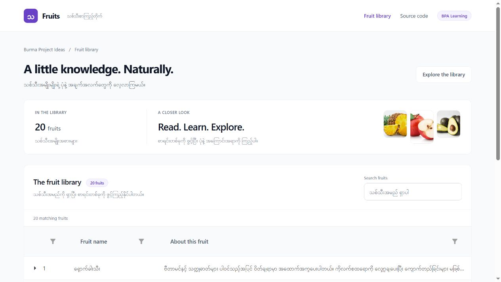

# Fruits (သစ်သီးအချက်အလက်)

သစ်သီးစာရင်း၊ ဖော်ပြချက်နဲ့ ဓာတ်ပုံတွေကို Card Catalog ကနေ ကြည့်နိုင်တဲ့ **.NET 8 Blazor WebAssembly + Tailwind CSS Project** ပါ။ [Burma Project Ideas](https://github.com/burma-project-ideas) အောက်မှာ JSON Data ဖတ်ခြင်းနဲ့ Card Layout အသုံးပြုခြင်းကို လေ့လာပြီး ကိုယ်နှစ်သက်တဲ့ Language နဲ့ ပြန်ရေးကြည့်နိုင်ဖို့ ထားပေးထားတာပါ။ [Live App ကို ဒီမှာ ဖွင့်နိုင်ပါတယ်](https://burma-fruits.vercel.app/)။

## အဓိက ပံ့ပိုးသူများနှင့် မူရင်း Data

- Git Contributors: [Sann Lynn Htun](https://github.com/sannlynnhtun-coding)၊ [Zin Lynn Htet](https://github.com/zinlynhtet)။ Git Contribution က မူရင်း Content ရေးသားသူဖြစ်ကြောင်း အလိုအလျောက် မဆိုလိုပါဘူး။
- Data: `BlazorWasm.Fruits/wwwroot/data/fruits.json`။
- Images: `BlazorWasm.Fruits/wwwroot/data/images/`။ မူရင်း Data/ဓာတ်ပုံရေးသားသူနဲ့ ဖြန့်ဝေခွင့်ကို Repository မှာ မသတ်မှတ်ထားသေးပါဘူး။
- UI: Tailwind CSS + Native Blazor။ မူရင်း Data နဲ့ Contributor Credit ကို ဆက်လက်ထိန်းသိမ်းပါ။

## အသုံးပြုပုံ

1. Home မှာ သစ်သီးစာရင်းကို ကြည့်ပါ။
2. Search မှာ သစ်သီးအမည် ရိုက်ရှာပါ။
3. Card မှာ Read about this fruit ကို ဖွင့်ပြီး ဖော်ပြချက်ကို ဖတ်ပါ။
4. Row ကို Expand လုပ်ပြီး သက်ဆိုင်ရာ ဓာတ်ပုံနဲ့ Description ကို ဖတ်ပါ။ တစ်ကြိမ်မှာ Row တစ်ခုကိုပဲ Expand လုပ်ပါတယ်။

## App ရဲ့ Workflow

1. `Program.cs` က Blazor App နဲ့ HttpClient ကို Register လုပ်ပါတယ်။
2. `Pages/Home.razor.cs` ရဲ့ `OnInitializedAsync` က `data/fruits.json` ကို `FruitModel[]` အဖြစ် ဖတ်ပါတယ်။
3. ဖတ်ထားတဲ့ Records ကို Native Blazor Card Layout မှာ Bind လုပ်ပါတယ်။ Search Input က Name ကို Case-insensitive Filter လုပ်ပြီး Matching Count ကို ပြပါတယ်။
4. Row Detail Template က `data/images/{Id}.jpg` နဲ့ Description ကို ပြပါတယ်။

Fruit-name Search၊ Empty Result၊ Loading နဲ့ Data-load Error States ပါဝင်ပါတယ်။

## Project ဖွဲ့စည်းပုံ

| Path | တာဝန် |
| --- | --- |
| `BlazorWasm.Fruits/Pages/Home.razor` | Search၊ Grid နဲ့ Expanded Row Template |
| `BlazorWasm.Fruits/Pages/Home.razor.cs` | JSON Loading နဲ့ Page State |
| `BlazorWasm.Fruits/Models/FruitModel.cs` | Id၊ Name၊ Description |
| `BlazorWasm.Fruits/wwwroot/data/` | JSON Catalog နဲ့ Images |
| `BlazorWasm.Fruits/Layout/` | Shared Layout နဲ့ Navigation |

## Local မှာ Run မယ်

.NET 8 SDK လိုပါတယ်။

```sh
git clone https://github.com/burma-project-ideas/fruits.git
cd fruits
dotnet restore BlazorWasm.Fruits.sln
dotnet run --project BlazorWasm.Fruits/BlazorWasm.Fruits.csproj
```

Terminal က ပြတဲ့ Local URL ကို ဖွင့်ပါ။

## Build နဲ့ Deployment

```sh
dotnet build BlazorWasm.Fruits.sln -c Release
dotnet publish BlazorWasm.Fruits/BlazorWasm.Fruits.csproj -c Release -o artifacts/publish
```

Published Files က `artifacts/publish/wwwroot` မှာ ရှိပါတယ်။ Static Host မှာ အဲဒီ Folder ကို Serve လုပ်နိုင်ပါတယ်။ Production ကို Vercel မှာ Deploy လုပ်ထားပြီး [Live App](https://burma-fruits.vercel.app/) ကို အသုံးပြုနိုင်ပါတယ်။ .NET Publish ပြီးသား Static Files ကို Vercel Build Output API Format နဲ့ `vercel deploy --prebuilt --prod` သုံးကာ Deploy လုပ်ထားတာပါ။ Published File တွေကို အရင် Serve ပြီး Client-side Routes အတွက် `index.html` Fallback သုံးပါတယ်။ လက်ရှိ Deployment က Manual CLI Deployment ဖြစ်ပြီး Git Push ကနေ Auto-deploy မသတ်မှတ်ထားသေးပါဘူး။

## Data ကို လေ့လာမယ်

JSON ထဲက `Id` နဲ့ Image File အမည်ကို တွဲသုံးပါတယ်။ Record ထပ်တိုးရင် Unique Id၊ Name၊ Description နဲ့ `images/{Id}.jpg` ကို အတူထည့်ပါ။ UI က JSON ဖတ်ထားတဲ့အတွက် Backend Database နဲ့ Account မလိုပါဘူး။

## စစ်ဆေးမယ်

Release Build၊ JSON Loading၊ Search နဲ့ Expand လုပ်တဲ့အခါ Image/Description မှန်ကန်မှုကို စမ်းပါ။ လက်ရှိ Repo မှာ Automated Test Project မပါသေးပါဘူး။

## ကိုယ်တိုင် ပြန်ရေးကြည့်ချင်ရင်

JSON → Typed Model → Cards → Detail View ဆိုတဲ့ Flow ကို ပြန်ရေးကြည့်ပါ။ Search ရလဒ်၊ Empty State နဲ့ Details ပြောင်းလဲမှုကို အတူစမ်းပါ။ Bug Report၊ Documentation နဲ့ Data Source Credit တွေကို Issue / Pull Request နဲ့ ပံ့ပိုးနိုင်ပါတယ်။

## UI Design Update

The fruit catalog uses a responsive Tailwind CSS card layout with native expandable details and instant name search. Radzen and Bootstrap are no longer used. Rebuild the checked-in stylesheet with `npm ci && npm run build:css` after changing utility classes.

The current interface follows [PrebuiltUI](https://prebuiltui.com/)'s visual direction: spacious white surfaces, subtle grid backgrounds, gradient headings, rounded cards, and pill controls. These patterns are implemented with CSS and native Blazor components; no React migration or new UI dependency is required. The earlier shared Blazor foundation remains in place.

The redesign preserves application data, calculations, and browser storage keys. Responsive layouts and visible keyboard focus remain available. Myanmar text uses the self-hosted Padauk font; its license is retained in `wwwroot/fonts/OFL-Padauk.txt`.



[Mobile preview](screenshots/redesign-mobile.jpg)
